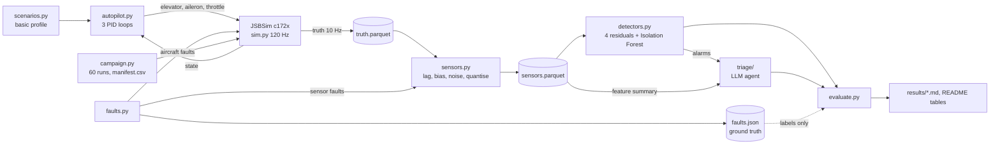
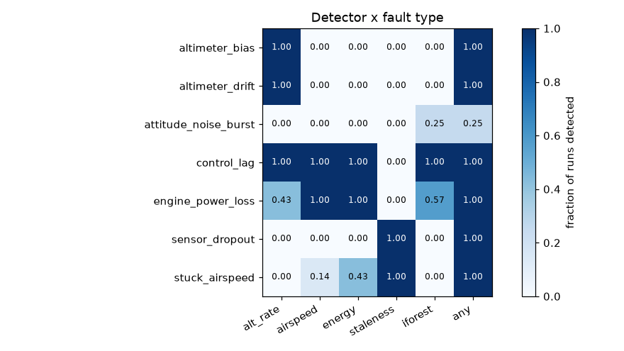

# flightsim-fault-harness

[](https://github.com/Madhubala1985/flightsim-fault-harness/actions/workflows/ci.yml)
[](LICENSE)
[](pyproject.toml)

A fault-injection and fault-detection test bench built on the
[JSBSim](https://github.com/JSBSim-Team/jsbsim) flight dynamics engine. A
Cessna 172 flies a scripted profile under a simple three-loop autopilot; truth
is logged at 10 Hz and turned into noisy sensor channels. Seven fault types
(frozen pitot, altimeter bias and drift, attitude noise, sensor dropout, engine
power loss, control lag) are injected into those channels or into the aircraft
at randomised times. Five detectors that see only the sensor channels raise
alarms; an LLM triage agent that sees only the alarms and a feature summary
names the fault and a next check. Everything is evaluated against the injected
ground truth, and a replay gate over recorded faulted runs must pass before any
detector change ships.

## Architecture



The dashed edge is the only place ground truth meets the detectors or the
agent: after the fact, for scoring.

## Run it in three commands

```bash
python3 -m venv .venv && source .venv/bin/activate && pip install -e ".[dev]"
make campaign fit        # 60 runs (~2.5 min), then fit detectors on the nominal ones
make test results        # 25 tests incl. the replay gate, then regenerate results/ and this README
```

Optional: `make triage` runs the LLM agent over the campaign's alarms. It needs
`ANTHROPIC_API_KEY` in `.env` (see `.env.example`) or `--backend ollama` for a
local model. Responses are cached under `triage_cache/`; `make results` reads
that cache offline and never calls the network.

**Status of the triage results:** `triage_cache/` is empty in this repository
because no API key was available when it was built. The key is loaded from
`.env`, which is git-ignored, and is never committed. The "Triage agent"
section below therefore shows a skip notice; the code and its offline tests
are complete, and running `make triage` once with a key (or a local Ollama
model) fills the cache and the table.

Other entry points: `python -m fsfh fly --scenario basic --seed 1 --out runs/`
for one flight, `python -m fsfh plot <run_dir>` for truth vs sensors with
fault windows shaded, `python scripts/gain_sweep.py` for how the autopilot
gains were chosen.

## Results

Every number below is written by `make results` from `runs/raw/`, `models/`
and `triage_cache/`. Nothing is typed by hand. The per-run flight table is in
[`results/runs.md`](results/runs.md); the figure is `results/confusion.png`.

<!-- eval:start -->
### Detection per fault type (102 faulted runs, any detector)

| fault_type | runs | detection_rate | median_ttd_s | pre_onset_false_alarms | pre_onset_per_hour |
|---|---|---|---|---|---|
| altimeter_bias | 12 | 1.00 | 0.50 | 2 | 2.26 |
| altimeter_drift | 13 | 1.00 | 5.80 | 0 | 0.00 |
| attitude_noise_burst | 15 | 0.07 | 118.60 | 2 | 1.47 |
| control_lag | 11 | 1.00 | 8.80 | 0 | 0.00 |
| engine_power_loss | 19 | 1.00 | 4.10 | 1 | 0.57 |
| sensor_dropout | 20 | 1.00 | 3.30 | 1 | 0.66 |
| stuck_airspeed | 12 | 1.00 | 3.50 | 1 | 0.82 |

Time-to-detect is measured from fault onset; a run counts as detected if an alarm starts between onset and 10 s after the fault ends.

### False alarms on held-out nominal runs (14 runs, 2.57 flight hours)

| detector | events | per_hour |
|---|---|---|
| alt_rate | 0 | 0.00 |
| airspeed | 5 | 1.95 |
| energy | 0 | 0.00 |
| staleness | 0 | 0.00 |
| iforest | 0 | 0.00 |
| any | 5 | 1.95 |

Held-out = nominal runs used neither for training nor for threshold validation.

Pooled estimate ('any' detector) over all fault-free time — 2.57 held-out nominal hours plus 8.37 pre-onset hours on faulted runs: 12 alarm events in 10.94 hours, about 1.1 per hour.

### Which detector fires for which fault (fraction of runs detected)

| fault_type | alt_rate | airspeed | energy | staleness | iforest | any |
|---|---|---|---|---|---|---|
| altimeter_bias | 1.00 | 0.00 | 0.00 | 0.00 | 0.00 | 1.00 |
| altimeter_drift | 1.00 | 0.00 | 0.00 | 0.00 | 0.00 | 1.00 |
| attitude_noise_burst | 0.00 | 0.00 | 0.00 | 0.00 | 0.07 | 0.07 |
| control_lag | 1.00 | 1.00 | 1.00 | 0.00 | 1.00 | 1.00 |
| engine_power_loss | 0.26 | 1.00 | 1.00 | 0.00 | 0.26 | 1.00 |
| sensor_dropout | 0.00 | 0.00 | 0.00 | 1.00 | 0.00 | 1.00 |
| stuck_airspeed | 0.00 | 0.25 | 0.25 | 1.00 | 0.00 | 1.00 |



### Triage agent (ollama / llama3.2:3b, 261 windows, served from cache: 261, new calls: 0)

The agent sees only the alarm list and a sensor feature summary for each window, never truth or the fault log. Windows are chosen from alarms alone; the label is assigned afterwards from the fault log.

Overall accuracy on fault windows: 0.24. Faulted runs with no alarm (untriaged): 7.

| fault_type | windows | accuracy | said_unknown | mean_confidence |
|---|---|---|---|---|
| altimeter_bias | 19 | 0.00 | 1.00 | 0.00 |
| altimeter_drift | 21 | 0.00 | 1.00 | 0.00 |
| attitude_noise_burst | 3 | 0.00 | 1.00 | 0.00 |
| control_lag | 14 | 0.00 | 0.29 | 0.58 |
| engine_power_loss | 19 | 0.95 | 0.05 | 0.80 |
| sensor_dropout | 20 | 0.40 | 0.55 | 0.34 |
| stuck_airspeed | 14 | 0.00 | 0.57 | 0.38 |

Nominal windows: 151; said 'unknown' on 0.84 of them, named a fault on 0.16.

Calibration (expected calibration error 0.506):

| confidence_bin | windows | mean_confidence | accuracy |
|---|---|---|---|
| [0.0, 0.5) | 2 | 0.00 | 1.00 |
| [0.7, 0.9) | 57 | 0.84 | 0.32 |
| [0.9, 1.0) | 8 | 1.00 | 0.75 |
<!-- eval:end -->

## What the detectors cannot see

- **Truth.** Detectors and the triage agent read `sensors.parquet` only.
  `truth.parquet` and `faults.json` are used by `evaluate.py` to score them.
- **Control commands.** Elevator, aileron and throttle are not sensor
  channels. RPM is the only proxy for power, so `engine_power_loss` is inferred
  from RPM and the energy balance, and `control_lag` only from its effect on
  the flight path.
- **A fault that does not move the residuals.** An altimeter bias is visible
  only at the step; a slow drift inside the vertical-speed noise, or attitude
  noise with no kinematic consequence, is mostly missed. The confusion table
  above shows this for `attitude_noise_burst`.
- **A fault the autopilot hides.** The autopilot flies on truth, so a sensor
  fault never changes the flight. This is deliberate: it isolates sensor
  faults from aircraft faults for scoring — if the autopilot flew on faulted
  sensors, every sensor fault would also become a trajectory fault and the
  two classes could not be separated. Closing the loop on sensed values is
  the natural next step. An aircraft fault that the autopilot compensates
  for well (mild control lag in cruise) leaves little trace in the sensors.
- **Anything before the first alarm.** The triage agent only receives windows
  that a detector flagged, so its accuracy is conditional on detection.

## Limitations

- **Simulator only.** JSBSim's `c172x` model, no wind, turbulence, weight
  variation or ground effect. The flight is deterministic; the seed changes
  sensor noise and fault draws only.
- **One aircraft, one scenario.** Autopilot gains, residual coefficients and
  the Isolation Forest were all fitted on this aircraft flying this profile.
  None of it is claimed to transfer.
- **Simple autopilot.** Three cascaded PI loops with rate damping, no rudder
  or yaw damper, no coordinated turns. There is a small roll and heading
  wander in cruise (about +/-1.5 deg). Climb rate is capped at 400 fpm because
  at 100 kts and 5000 to 6000 ft the model saturates the throttle at 500 fpm;
  whether that matches the real aircraft was not checked. Mixture is fixed at
  0.85, a guess at a cruise setting.
- **No real sensor models.** Noise, bias and quantisation levels are plausible
  round numbers, not instrument specifications. The 2 s VSI lag is a round
  number in the right range for a mechanical instrument.
- **Fault magnitudes are illustrative ranges**, chosen so each fault is
  visible in the channels, not taken from failure statistics.
  `engine_power_loss` limits throttle authority rather than modelling an
  engine, because JSBSim's piston engine exposes no partial-power property.
- **Residual coefficients are fitted.** The airspeed and energy checks have
  physics structure but learned drag and propeller terms.
- **Small evaluation.** False-alarm rates come from a few fault-free flight
  hours (the held-out nominal runs plus pre-onset segments; the pooled
  estimate in the evaluation section is the honest number, roughly the
  one-per-hour target rate). Rates estimated from hours this few carry wide
  error bars. Triage accuracy is on a few hundred windows from one
  campaign seed.
- **The triage prompt contains reasoning hints** written from the fault
  definitions, so the agent is scored on faults it was told about.

## How to add a fault type

1. In `src/fsfh/faults.py` add the name to `FAULT_TARGET` (`"sensor"` or
   `"aircraft"`) and its magnitude unit to `MAGNITUDE_UNITS`.
2. Implement it: a sensor fault is one `elif` in `apply_sensor_faults`
   (operate on the masked rows of the sensor frame); an aircraft fault is a
   branch in `AircraftFaultInjector.throttle` or `.elevator`, or a new hook
   called from the loop in `sim.py`.
3. Give it a magnitude range in `MAGNITUDE_RANGES` in `campaign.py` so the
   campaign draws it.
4. Add the literal to `FaultLabel` in `triage/schema.py` (the assert there
   fails otherwise) and, if useful, one sentence of reasoning hint in
   `triage/agent.py`.
5. Add a test in `tests/test_faults.py` that the fault is visible in the
   sensor frame while truth is untouched (sensor fault) or that the flight
   changes (aircraft fault). Then `make campaign fit results`, pick a detected
   run as a new fixture under `runs/fixtures/` with a line in
   `expectations.json`, and confirm `pytest tests/test_replay.py` passes.

## Project layout

```
src/fsfh/
  autopilot.py   PID class, gains, three control loops
  scenarios.py   Scenario / Segment data and the "basic" scenario
  sim.py         JSBSim setup, trim, main loop, 10 Hz truth logging
  sensors.py     noisy sensor channels derived from truth
  faults.py      Fault dataclass, sensor-level and aircraft-level injection
  campaign.py    nominal/faulted run mix with manifest.csv
  detectors.py   residual detectors, Isolation Forest, thresholds, fit
  evaluate.py    detection rate, time-to-detect, false alarms, confusion table
  triage/        LLM triage agent: schema, features, backends + cache, agent, evaluation
  results.py     results/*.md and the README tables
  runlog.py      write/read a run directory
  plot.py, cli.py
tests/           test_flight, test_faults, test_detectors, test_triage, test_replay (release gate)
models/          fitted detector model (committed so CI can run the replay gate)
runs/fixtures/   five recorded faulted runs + expectations.json
runs/raw/        campaign output (git-ignored)
results/         generated tables and figure
triage_cache/    cached LLM responses (committed; read offline by make results)
```

## Citation

If you use this harness, cite it as:
`Madhubala1985 (2026). flightsim-fault-harness: a fault-injection and detection test bench on JSBSim. https://github.com/Madhubala1985/flightsim-fault-harness`
(see `CITATION.cff`).

## License

MIT, see [LICENSE](LICENSE).
